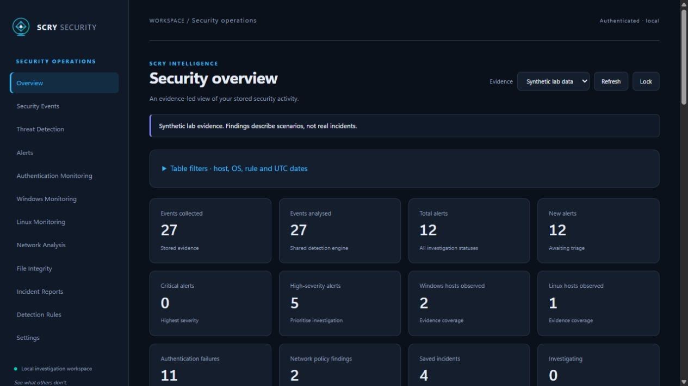
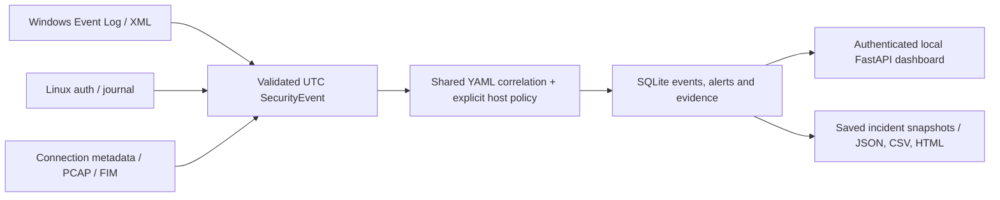

# Scry-Security


**See what others don't.**

Windows-first defensive security monitoring in Python. Windows and Linux
collectors translate native records into a shared UTC schema, 25 configurable
YAML detections, evidence-backed alerts and saved investigations.

**Windows-first release candidate · 1.0.0rc1 · MIT.** Windows 10/11 are the primary
target platforms; native verification has run on Windows 11. Linux functionality
is experimental until genuine native authentication collection can be verified.
The shared architecture and Windows/Ubuntu automated tests remain supported.
No Ubuntu VM is required for this release. See the evidence and remaining gates
in the [release checklist](docs/release_checklist.md). No final v1.0 release is claimed.



## What it does

- Parses Windows Security, PowerShell and Defender XML and Linux authentication,
  account, sudo and journal records; preserves available native evidence.
- Correlates authentication failures, multiple accounts and success after failure;
  reviews account, privilege, service, task and process activity against explicit
  host policy. Findings are investigation leads, not confirmed compromise.
- Analyses psutil connection snapshots and optional offline PCAP/DNS metadata.
  Collection never starts packet capture automatically.
- Stores events, alert status history, incident snapshots and source checkpoints
  in SQLite through SQLAlchemy.
- Provides a token-protected local FastAPI dashboard with filters, charts,
  investigation views and JSON/CSV/HTML exports.
- Compares explicitly approved SHA-256 file baselines for creation, modification
  and deletion without collecting file contents.

The shared core uses Python 3.12+. Windows 10/11 are primary targets;
Ubuntu/Debian adapters remain experimental.
Native collection depends on source availability, audit policy and permissions.
Mocked collectors and fixtures do not establish native compatibility.

## Install

From the repository root, Windows PowerShell:

```powershell
python -m venv .venv
.\.venv\Scripts\python.exe -m pip install -e ".[dev]"
.\.venv\Scripts\python.exe -m scry_security --check
```

Ubuntu/Debian, with Python 3.12+ and its matching venv package:

```bash
python3 -m venv .venv
.venv/bin/python -m pip install -e '.[dev]'
.venv/bin/python -m scry_security --check
```

Add `[windows]` for the native Event Log adapter or `[packet-analysis]` for offline
Scapy analysis. Neither optional dependency is required for fixture-based learning.
See [installation](docs/installation.md), [Windows setup](docs/windows_setup.md)
and [Linux setup](docs/linux_setup.md) for source prerequisites and limitations.

## Try a synthetic investigation

```powershell
.\.venv\Scripts\python.exe scripts/seed_demo.py --database data/demo.sqlite
$env:SCRY_API_TOKEN = (& .\.venv\Scripts\python.exe -c "import secrets; print(secrets.token_urlsafe(32))")
$env:SCRY_API_TOKEN
.\.venv\Scripts\python.exe -m scry_security --serve --database data/demo.sqlite
```

Open http://127.0.0.1:8765 and enter the generated token. Select **Synthetic lab
data**, investigate an alert, save its status and export a saved incident.
The seed script requires a new database/laboratory path and never overwrites a
previous demonstration. It creates disposable file-change evidence; it reads no
real authentication logs. Linux equivalents and a recruiter walkthrough are in
[the demonstration guide](docs/demonstration.md).

For example, five synthetic SSH failures followed by success produce both a
repeated-failure finding and a success-after-failure finding. The records support
investigation; owner verification and surrounding telemetry determine intent.
Read the three [example investigations](incident_reports/) in JSON, CSV and HTML.

## Architecture



OS-specific collectors handle acquisition; shared parsers, detection, storage and
reporting avoid duplicating security logic. The stack uses Pydantic, FastAPI,
SQLAlchemy, SQLite, Uvicorn, psutil and self-hosted Chart.js. Optional pywin32 and
Scapy stay at the acquisition boundary. See [architecture](docs/architecture.md)
and the staged [learning roadmap](docs/roadmap.md).

## Configure and extend

| Guide | Purpose |
| --- | --- |
| [Monitoring](docs/monitoring.md) | Explicit TOML sources, one-shot/loop polling and checkpoints |
| [Detection logic](docs/detection_logic.md) | YAML rules, thresholds, false positives and ATT&CK references |
| [Host policy](docs/detection_policy.md) | Approved accounts, actors, networks and archived policy context |
| [Dashboard](docs/dashboard.md) | Token generation, loopback serving and investigation workflow |
| [Network analysis](docs/network_analysis.md) | Snapshot limitations and bounded offline PCAP analysis |
| [File integrity](docs/file_integrity.md) | Approved scopes, hashing and safe comparison failures |
| [Incident response](docs/incident_response.md) | Evidence versus interpretation and export behaviour |
| [Troubleshooting](docs/troubleshooting.md) | Permission, source, configuration and installation failures |

`.env.example` lists validated settings; `.env` files are not automatically loaded.
Collection is opt-in. `--check` reads configuration and host metadata without
starting a collector. The CLI's `--help` lists the implemented commands.

## Test and contribute

```powershell
.\.venv\Scripts\python.exe -m pytest --cov=scry_security --cov-branch
.\.venv\Scripts\python.exe -m ruff check .
.\.venv\Scripts\python.exe -m ruff format --check .
```

Use `.venv/bin/python` on Linux. GitHub Actions defines Windows/Ubuntu runners
with Python 3.12/3.13, plus dependency auditing. See
[verification](docs/verification.md), [contributing](CONTRIBUTING.md)
and [security reporting](SECURITY.md).

## Security, limitations and roadmap

Monitor only authorised systems. Run with the least privileges needed by each
source. Raw event evidence can contain sensitive command lines and account data:
protect the database, tokens and exports, and never commit operational telemetry.
The API binds to loopback and requires a bearer token; it is not a multi-user
remote SIEM. See [the security model](docs/security_model.md).

Verified on native Windows 11: Security/System acquisition, genuine 4624/4625/4672
handling, raw evidence persistence, repeat collection and restart checkpoints.
Private native test evidence is retained locally. Remote correlation requires an
actual source IP; the default local rule has a ten-failure threshold.
Verified through automated tests only: full 25-rule positive/negative coverage,
other Windows event mappings and many error branches. Experimental on Linux:
auth-file/journal acquisition, with native OS telemetry still unverified.
Not yet verified: native Windows 10, remote-IP failure/success correlation and
long-duration operation. See the checklist for exact evidence and feature status.
Implemented: the shared pipeline, dashboard, reporting, explicit polling and file
comparison. Planned: final v1.0 approval,
installation/service hardening, broader telemetry and a future PostgreSQL option.
There is no full Sigma compatibility, automatic remediation, lossless collection
guarantee or live packet capture. ATT&CK mappings describe relevant behaviour,
not attribution or proof of compromise.

Licensed under [MIT](LICENSE). The bundled Chart.js distribution retains its MIT
notice. [Release gates](docs/release_checklist.md) track the evidence still needed
for a professional v1.0 claim.
