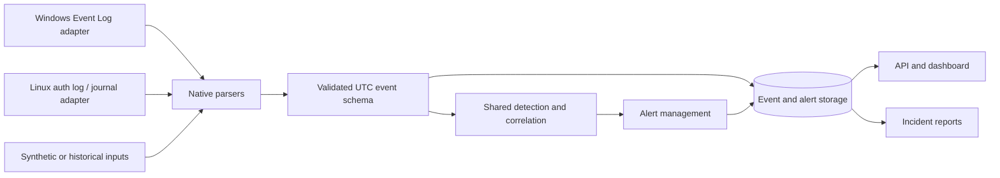

# Architecture

## Shared core, native collection

Windows and Linux are equal design targets. Their telemetry differs, but the
meaning of a normalised authentication failure can be shared. Collection source
and native event identifiers must remain attached to the evidence.



This diagram is the intended architecture. Stages 1–9 implement the core,
initial collection/parsing, detection, alert workflow and SQLite storage.
The web interface and incident exports are the next stages.

For example, Windows event 4625 and a Linux SSH failure will map to a common
authentication-failure event. A shared rule can count failures within a time
window, grouped by host and source address. Native fields remain available for
investigation. Missing addresses must not be treated as one shared attacker.

## Refinements to the brief

- Separate native reading from parsing. Parsers can accept historical fixtures
  without administrator permissions or platform-specific imports.
- Keep optional Windows imports inside Windows adapters. Installing or importing
  the core on Linux must not require pywin32; Linux sources must not be assumed
  present on every distribution.
- Detect capabilities separately from OS family. Windows identification does not
  prove Security log access, audit policy, or PowerShell telemetry availability.
  Linux identification does not prove auth.log, systemd, or journal access.
  Future collectors will report available, unavailable, permission-denied, and
  degraded states rather than silently showing zero events.
- Keep privileged collection separate from the web process. The future dashboard
  should query stored results without inheriting collector privileges. Transport
  and authentication will be designed before introducing remote collection.
- Preserve raw evidence where justified, with retention and access controls.
  Deduplication and durable source cursors will be needed for polling, restart,
  journal continuation, and log rotation. Event time and ingestion time must be
  distinct; timezone-free historical records need explicit source context.
- Bound buffers and correlation windows. An input flood must not cause unbounded
  memory growth. Malformed records need isolated errors and health counters.
- File integrity monitoring will use explicit paths and separate baseline approval
  from comparison; silently accepting changed hashes defeats the purpose.

## Technology decisions

Python 3.12+ is the initial baseline. `pyproject.toml` owns metadata and dependencies;
`src/` separates installable code from repository files. Pydantic Settings supplies
typed environment validation. Python logging and pathlib cover console diagnostics
and native filesystem paths without extra runtime packages.

Stages 2–9 introduce Pydantic event models, pywin32 on Windows only, Linux file
and journal readers, safe YAML loading, psutil metadata, optional offline Scapy
analysis, SQLAlchemy and SQLite. Stage 10 adds FastAPI/Uvicorn with HTML/CSS/JavaScript
and Chart.js. PostgreSQL and live capture remain later options. Dependencies are
added when their implementation and tests exist. No Sigma compatibility is claimed.

## Repository structure

Foundation layout (later package contents are documented in stage guides):

```text
pyproject.toml
src/scry_security/
    __init__.py
    __main__.py
    main.py
    core/
        config.py
        platform.py
        logging.py
tests/unit/test_foundation.py
docs/
    architecture.md
    stage-1.md
    roadmap.md
    security_model.md
.github/workflows/tests.yml
```

Implemented packages now also include collectors/{windows,linux,network}, parsers,
detection, alerts, database and services. API, reports and dashboard follow.
The default rule catalogue is packaged under `rule_catalog/` so installed commands
can load it independently of the checkout. Root `rules/` documents custom catalogues;
synthetic sample logs and future incident examples remain outside the package.
